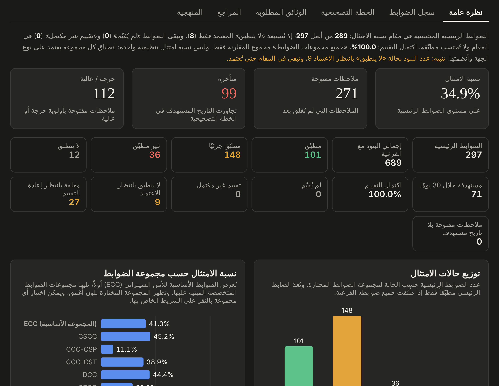

# GRC & Cybersecurity Compliance Portfolio

**Raseel Almutairi** · Cybersecurity GRC Specialist

Certifications: CompTIA Security+ · GRCP · GRCA · [LinkedIn](https://www.linkedin.com/in/raseel-almutairi/)

A collection of my work in cybersecurity governance, risk and compliance. All data is sample data for demonstration.

---

## 1. SAMA Cyber Security Framework Self-Assessment Tool (English)

A self-assessment of the 32 subdomains of the SAMA Cyber Security Framework v1.0, using SAMA's own maturity model (levels 0 to 5, minimum required level 3). Every "No" answer becomes an action in the action plan, with three-stage escalation and a ready-to-send email for each action.

- [Open the tool](https://raseel-almutairi.github.io/portfolio/sama-tool/)
- **Excel assessment:** [Sample data](https://raseel-almutairi.github.io/portfolio/sama-tool/SAMA_CSF_Assessment_Sample.xlsx) · [Blank, ready to use](https://raseel-almutairi.github.io/portfolio/sama-tool/SAMA_CSF_Assessment_Blank.xlsx)
- [Details and how it works](sama-tool/)

## 2. NCA Controls Compliance Tracker (Arabic interface)

A compliance tracker for 8 sets of NCA (National Cybersecurity Authority) controls, with findings, a corrective action plan, and the required documents and expected outputs for each control from the official guidelines.

- [Open the tool](https://raseel-almutairi.github.io/portfolio/nca-tool/)
- **Excel register:** [Sample data](https://raseel-almutairi.github.io/portfolio/nca-tool/NCA_Compliance_Register_Sample.xlsx) · [Blank, ready to use](https://raseel-almutairi.github.io/portfolio/nca-tool/NCA_Compliance_Register_Blank.xlsx)
- **Power BI report:** [View report (PDF)](https://raseel-almutairi.github.io/portfolio/nca-powerbi/5_Sample_Report.pdf) · [Power BI folder](nca-powerbi/)
  - The report is from an earlier version (35.8%); the current figure in the web and Excel is 34.9%.
- [Details and calculation method](nca-tool/)

> **The web tools are for display only:** they show sample data and collect no data. For real use, download the blank Excel files, which run on your own device.

**Disclaimer:** These are personal initiatives, not official tools of the NCA or SAMA, and they do not replace their assessments. The official documents published by each authority are the reference.

---

## بالعربي

**رسيل المطيري** · مختصة في الحوكمة والمخاطر والامتثال للأمن السيبراني

الشهادات: CompTIA Security+ · GRCP · GRCA · للتواصل: [LinkedIn](https://www.linkedin.com/in/raseel-almutairi/)

مجموعة من أعمالي في الحوكمة والمخاطر والامتثال للأمن السيبراني. البيانات المستخدمة نموذجية لأغراض العرض.

### 1. أداة التقييم الذاتي لإطار الأمن السيبراني لساما (بالإنقليزي)

أداة تقييم ذاتي للمكونات الـ 32 في إطار الأمن السيبراني للبنك المركزي السعودي (ساما)، مبنية على نموذج النضج الخاص بساما من المستوى 0 إلى 5، والحد الأدنى المطلوب هو المستوى 3. كل إجابة «لا» تتحول تلقائياً إلى إجراء في خطة العمل، مع تصعيد على ثلاث مراحل وإيميل جاهز لكل إجراء.

- [عرض الأداة](https://raseel-almutairi.github.io/portfolio/sama-tool/)
- **ملف التقييم في Excel:** [نسخة ببيانات نموذجية](https://raseel-almutairi.github.io/portfolio/sama-tool/SAMA_CSF_Assessment_Sample.xlsx) · [نسخة فارغة للاستخدام الفعلي](https://raseel-almutairi.github.io/portfolio/sama-tool/SAMA_CSF_Assessment_Blank.xlsx)
- [تفاصيل الأداة وطريقة العمل](sama-tool/)

### 2. أداة متابعة الامتثال لضوابط الهيئة الوطنية للأمن السيبراني (بالعربي)

أداة لمتابعة الامتثال لـ 8 مجموعات من ضوابط الهيئة الوطنية للأمن السيبراني، مع الملاحظات والخطة التصحيحية، والوثائق المطلوبة والمخرجات المتوقعة لكل ضابط من الأدلة الإرشادية الرسمية.

- [عرض الأداة](https://raseel-almutairi.github.io/portfolio/nca-tool/)
- **سجل الامتثال في Excel:** [نسخة ببيانات نموذجية](https://raseel-almutairi.github.io/portfolio/nca-tool/NCA_Compliance_Register_Sample.xlsx) · [نسخة فارغة للاستخدام الفعلي](https://raseel-almutairi.github.io/portfolio/nca-tool/NCA_Compliance_Register_Blank.xlsx)
- **تقرير Power BI:** [عرض التقرير (PDF)](https://raseel-almutairi.github.io/portfolio/nca-powerbi/5_Sample_Report.pdf) · [مجلد Power BI](nca-powerbi/)
  - التقرير من نسخة سابقة (35.8%)، والنسبة الحالية في الويب و Excel هي 34.9%.
- [تفاصيل الأداة ومنهجية الاحتساب](nca-tool/)

> **الأدوات للعرض فقط:** تعرض بيانات نموذجية، ولا تجمع أي بيانات. وللاستخدام الفعلي، استخدم نسخ Excel الفارغة، وهي تعمل على جهازك.

**توضيح:** هذه الأعمال اجتهاد شخصي، وليست أدوات رسمية من الهيئة الوطنية للأمن السيبراني أو من ساما، ولا تغني عن تقييمهما. والمرجع المعتمد هو الوثائق المنشورة على موقع كل جهة.
