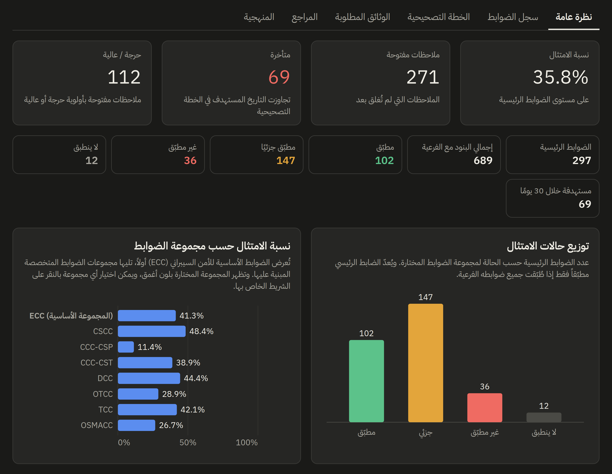

# ملف أعمال الحوكمة والمخاطر والامتثال للأمن السيبراني

مجموعة من أعمالي في الحوكمة والمخاطر والامتثال للأمن السيبراني. البيانات المستخدمة نموذجية لأغراض العرض.

## أداة متابعة الامتثال لضوابط الهيئة الوطنية للأمن السيبراني

أداة لمتابعة الامتثال لمجموعات الضوابط الثمانية، مع الملاحظات والخطة التصحيحية، والوثائق المطلوبة والمخرجات المتوقعة لكل ضابط من الأدلة الإرشادية الرسمية.

- [عرض الأداة](https://raseel-almutairi.github.io/portfolio/nca-tool/)
- [سجل الامتثال في Excel (يعمل دون Power BI)](https://raseel-almutairi.github.io/portfolio/nca-tool/NCA_Compliance_Register_Blank.xlsx)

> **الأداة للعرض فقط:** تعرض بيانات نموذجية مضمّنة فيها، ولا تتيح إدخال بيانات الجهة أو حفظها. وللاستخدام الفعلي، استخدم سجل الامتثال في Excel، أو قالب Power BI الفارغ.

## تقرير Power BI

نسختان بالتصميم والمعادلات نفسها، ويختلفان في البيانات فقط:

- **نسخة العرض:** [تنزيل التقرير ببيانات نموذجية (PBIX)](https://raseel-almutairi.github.io/portfolio/nca-powerbi/1_Sample_Report.pbix) · [بيانات العينة (Excel)](https://raseel-almutairi.github.io/portfolio/nca-powerbi/3_Sample_Data.xlsx) · [عرض التقرير بصيغة PDF](https://raseel-almutairi.github.io/portfolio/nca-powerbi/5_Sample_Report.pdf)
- **نسخة الاستخدام:** [تنزيل القالب الفارغ (PBIT)](https://raseel-almutairi.github.io/portfolio/nca-powerbi/2_Blank_Template.pbit) · [ملف البيانات الفارغ (Excel)](https://raseel-almutairi.github.io/portfolio/nca-powerbi/4_Blank_Data.xlsx)

تفاصيل الملفات وطريقة استخدام القالب في [مجلد Power BI](nca-powerbi/).

## منهجية الاحتساب

- نسبة الامتثال = الضوابط الرئيسية المطبّقة ÷ (إجمالي الضوابط الرئيسية − «لا ينطبق» المعتمد).
- لا يُعدّ الضابط الرئيسي مطبّقاً إلا إذا طُبّقت جميع ضوابطه الفرعية المنطبقة.
- تبقى الضوابط «لم يُقيّم» و«تقييم غير مكتمل» في المقام، حتى لا ترتفع النسبة لمجرد نقص التقييم.

**توضيح:** هذه الأعمال اجتهاد شخصي، وليست وثائق رسمية من الهيئة الوطنية للأمن السيبراني. والمرجع المعتمد هو الوثائق المنشورة على موقع الهيئة.

---

**رسيل المطيري**

مختصة في الحوكمة والمخاطر والامتثال للأمن السيبراني

الشهادات: CompTIA Security+ · GRCP · GRCA

للتواصل: [LinkedIn](https://www.linkedin.com/in/raseel-almutairi/)
