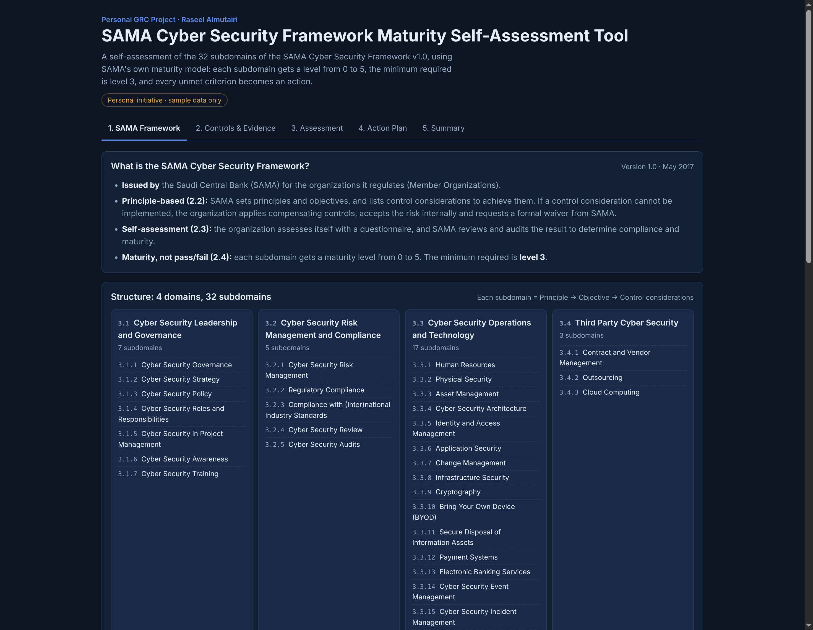

# GRC & Cybersecurity Compliance Portfolio

**Raseel Almutairi** · Cybersecurity GRC Specialist

Certifications: CompTIA Security+ · GRCP · GRCA · [LinkedIn](https://www.linkedin.com/in/raseel-almutairi/)

A collection of my work in cybersecurity governance, risk and compliance. All data is sample data for demonstration.

---

## 1. SAMA Cyber Security Framework Self-Assessment Tool

A self-assessment of the 32 subdomains of the SAMA Cyber Security Framework v1.0, using SAMA's own maturity model (levels 0 to 5, minimum required level 3). Every unmet criterion up to level 3 becomes an action in the action plan, linked to its control considerations, with three-stage escalation and a ready-to-send email.

- [Open the tool](https://raseel-almutairi.github.io/portfolio/sama-tool/) · [Details](sama-tool/)
- **Excel:** [Sample](https://raseel-almutairi.github.io/portfolio/sama-tool/SAMA_CSF_Assessment_Sample.xlsx) · [Blank](https://raseel-almutairi.github.io/portfolio/sama-tool/SAMA_CSF_Assessment_Blank.xlsx)

## 2. NCA Controls Compliance Tracker

A compliance tracker for 8 sets of NCA (National Cybersecurity Authority) controls, with findings, a corrective action plan, and the required documents and expected outputs for each control from the official guidelines.

- [Open the tool](https://raseel-almutairi.github.io/portfolio/nca-tool/) · [Details](nca-tool/)
- **Excel:** [Sample](https://raseel-almutairi.github.io/portfolio/nca-tool/NCA_Compliance_Register_Sample.xlsx) · [Blank](https://raseel-almutairi.github.io/portfolio/nca-tool/NCA_Compliance_Register_Blank.xlsx)
- **Power BI:** [Report (PDF, earlier version)](https://raseel-almutairi.github.io/portfolio/nca-powerbi/5_Sample_Report.pdf) · [Files](nca-powerbi/)

> The web tools are for display only. For real use, download the blank Excel files. These are personal initiatives and do not replace the assessments of the NCA or SAMA.

---

## بالعربي

**رسيل المطيري** · مختصة في الحوكمة والمخاطر والامتثال للأمن السيبراني

الشهادات: CompTIA Security+ · GRCP · GRCA · للتواصل: [LinkedIn](https://www.linkedin.com/in/raseel-almutairi/)

مجموعة من أعمالي في الحوكمة والمخاطر والامتثال للأمن السيبراني. البيانات المستخدمة نموذجية لأغراض العرض.

### 1. أداة التقييم الذاتي لإطار الأمن السيبراني لساما

أداة تقييم ذاتي للمكونات الـ 32 في إطار الأمن السيبراني للبنك المركزي السعودي (ساما)، مبنية على نموذج النضج الخاص بساما من المستوى 0 إلى 5، والحد الأدنى المطلوب هو المستوى 3. كل معيار غير مستوفى حتى المستوى 3 يتحول تلقائياً إلى إجراء في خطة العمل، مرتبط بضوابطه، مع تصعيد على ثلاث مراحل وإيميل جاهز.

- [عرض الأداة](https://raseel-almutairi.github.io/portfolio/sama-tool/) · [التفاصيل](sama-tool/)
- **Excel:** [نموذجي](https://raseel-almutairi.github.io/portfolio/sama-tool/SAMA_CSF_Assessment_Sample.xlsx) · [فارغ](https://raseel-almutairi.github.io/portfolio/sama-tool/SAMA_CSF_Assessment_Blank.xlsx)

### 2. أداة متابعة الامتثال لضوابط الهيئة الوطنية للأمن السيبراني

أداة لمتابعة الامتثال لـ 8 مجموعات من ضوابط الهيئة الوطنية للأمن السيبراني، مع الملاحظات والخطة التصحيحية، والوثائق المطلوبة والمخرجات المتوقعة لكل ضابط من الأدلة الإرشادية الرسمية.

- [عرض الأداة](https://raseel-almutairi.github.io/portfolio/nca-tool/) · [التفاصيل](nca-tool/)
- **Excel:** [نموذجي](https://raseel-almutairi.github.io/portfolio/nca-tool/NCA_Compliance_Register_Sample.xlsx) · [فارغ](https://raseel-almutairi.github.io/portfolio/nca-tool/NCA_Compliance_Register_Blank.xlsx)
- **Power BI:** [التقرير (PDF، نسخة سابقة)](https://raseel-almutairi.github.io/portfolio/nca-powerbi/5_Sample_Report.pdf) · [الملفات](nca-powerbi/)

> أدوات الويب للعرض فقط، وللاستخدام الفعلي حمّل نسخ Excel الفارغة. هذه الأعمال اجتهاد شخصي ولا تغني عن تقييم الهيئة الوطنية للأمن السيبراني أو ساما.
